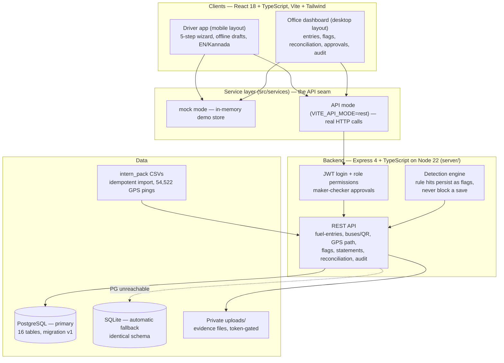

# FleetFuel Guard

**Fuel accountability for Vidyanagara PU College** — a mobile-first fuel-entry app for drivers,
a desktop fleet-monitoring dashboard for the office, and a real backend (PostgreSQL primary with
automatic SQLite fallback, JWT auth + RBAC,
idempotent CSV import, detection engine, reconciliation) built on the synthetic Aug–Oct 2026
diesel dataset (8 buses, 112 register fills, 82 pump statement lines, 54,522 GPS pings).

> **Important framing:** the app surfaces *discrepancies* with independent evidence and asks a
> human to review them. It never labels a transaction "fraud confirmed". Suspicious items are
> always marked **Needs review** / **Discrepancy detected**, and "amount at issue" is never
> presented as a confirmed loss.

---

## 1. Install & run

```bash
npm install
npm run dev        # frontend on http://localhost:5173 (demo/mock mode)
```

Other scripts:

```bash
npm run build      # type-check + production build to dist/
npm run preview    # serve the production build locally
```

### Backend (real database + APIs)

```bash
cd server
npm install
npm run dev        # boots on http://localhost:4000 — imports all 7 CSVs, seeds demo data
npm run smoke      # 53 end-to-end API checks on a throwaway database
npm run import     # re-run the idempotent CSV import manually
```

To run the **frontend against the real backend** (persistent records, server-side
permissions), copy `.env.example` to `.env.local`, uncomment the two `VITE_API_*` lines, start
the backend, and open the frontend as usual. Login is then username-based: `driver`, `manager`,
`accountant`, `principal` or `admin`, password `demo123`. Without that env file the app stays in
demo/mock mode (in-memory, any password).

## 2. System architecture

One React codebase, two experiences; one Express API; one database engine with a safety net.



- **Mock mode** keeps the demo self-contained (no network, no database) for evaluators.
- **API mode** makes the server the single source of truth: every screen reads a role-scoped
  `GET /bootstrap` snapshot and every action POSTs to the API, then re-reads the snapshot.
- The server is authoritative on all permissions (frontend guards are UX only) and never
  hard-deletes: corrections and audit events are append-only.

## 3. Tech stack

**Frontend (`src/`)**

| Layer | Technology | Used for |
|---|---|---|
| UI framework | React 18 + TypeScript 5.5 | one codebase, two layouts (mobile driver / desktop office) |
| Build | Vite 5 | dev server + production bundles |
| Styling | Tailwind CSS 3 | utility-first styling across both layouts |
| Routing | React Router 6 | wizard steps + office pages |
| Charts | Recharts 2.12 | spend and efficiency charts |
| Icons / QR | lucide-react, qrcode.react | icons; printable bus QR codes |

**Backend (`server/`)**

| Layer | Technology | Used for |
|---|---|---|
| Runtime | Node.js 22 | API server, CSV import, smoke tests |
| Framework | Express 4 | REST API, middleware, multipart uploads |
| Language | TypeScript (strict) | all server code |
| Database | PostgreSQL (pg) primary · SQLite (better-sqlite3) fallback | 16-table schema, automatic fallback when PG is unreachable |
| Auth | jsonwebtoken + bcryptjs | JWT sessions (12 h), password hashing |
| Uploads | multer | evidence file ingestion with type/size validation |
| Validation | zod | request-body schemas |
| Dev tooling | tsx, esbuild | instant TS execution; single-file production bundle |

**Testing:** API smoke suite (53 end-to-end checks on a fresh database) + frontend engine
smoke (24 checks on rules and reconciliation).

The API contract, permission matrix and demo accounts are documented in
[`server/API.md`](server/API.md).

## 4. Demo roles

Mock mode uses the role selector on the sign-in screen (any password works). **API mode** uses
the same four demo profiles plus `admin`, authenticated by the backend with JWT:

| Role | Who | Sees |
|---|---|---|
| Driver — fuel entry | Hanumanthappa G (bus VB-07) | Mobile app: record fills, own entries, offline mode |
| Transport Manager | Ravi S | Dashboard, all entries, flagged fills + investigation, pump statement, buses & QR, audit log |
| Accountant | Lakshmi Devi | Dashboard, pump statement reconciliation, entries, flags, audit log |
| Principal / Approver | Dr. Suresh Rao | Dashboard, approval inbox, flags, entries, audit log |

Log out / switch role is available in the driver bottom bar and the office sidebar.

**Permissions:** in mock mode the role guard is a frontend prototype guard only. In API mode
every permission (who may create entries, review flags, import statements, decide approvals) is
enforced server-side — see the matrix in [`server/API.md`](server/API.md) — and the maker of an
approval can never decide it.

## 5. What is implemented

A screen-by-screen inventory lives in
[`docs/PartC-Mapping.md`](docs/PartC-Mapping.md). Highlights:

- **Login** with demo role selector and clear prototype disclaimer
- **Driver mobile home** with assigned bus, offline toggle, recent entries
- **5-step pump entry wizard** — scan/simulated QR with error + manual fallback, fill details with
  live rate/capacity warnings, evidence photos with upload-failure/retry, location permission
  states, review + confirmation, saved/needs-review result
- **Office dashboard** — KPIs (register spend ₹12,55,535.02, 112 entries, 8 buses, review counts),
  monthly spend chart, derived efficiency chart, recent entries table with filters
- **Flagged fills list + investigation detail** with evidence-comparison cards, notes, timeline
  and manager actions
- **Pump statement reconciliation** with demo CSV, match categories, reviewer decisions with
  mandatory notes, CSV export
- **Principal approval inbox** with approve/reject/request-info, reasons and self-approval block
- **Buses & QR management** with printable QR (bus ID only) and manual lookup
- **Audit log** of creations, views, notes, status changes and corrections — no hard deletes

## 6. Seeded cases & assumptions

The nine seeded investigation cases come straight from `findings.csv` (VB-03 rate premium,
VB-02 amount mismatch, unknown vehicle KA 99 MX 4417, VB-03 statement-only bill, VB-06 tank
conflict, VB-04 duplicate pair, VB-08 holiday cash fill, VB-02 short-interval refill, cash
claims without receipts). Data and rule assumptions are listed in
[`docs/PartC-Mapping.md`](docs/PartC-Mapping.md#5-mock-data--rule-assumptions).

## 7. Known limitations

- **Mock mode:** everything is client-side state; refreshing resets the demo. Run API mode for
  persistence.
- "Uploads", QR scanning and sync are **simulated and labelled as demo** in mock mode; in API
  mode uploads are real files stored outside the public web root and served only through an
  authenticated endpoint.
- GPS coordinates are stored only if the browser actually provides them; otherwise the entry is
  marked "Location unavailable". No coordinates are ever invented.
- The printed QR encodes only `vpc-fleetfuel:bus:VB-xx` (stable bus ID, no personal data).
- Driver-facing text has an English/Kannada toggle; office screens are English-only.
- The efficiency chart is a **derived estimate** (odometer deltas ÷ litres) and is labelled as
  such — it is not a verified mileage figure.
- Drafts queued offline lose their queued photo bytes if the page is reloaded before sync; the
  entry syncs and the low-severity `ODOMETER_PHOTO_MISSING` flag records the gap.

## 8. Backend

The backend lives in [`server/`](server/):

- PostgreSQL schema + migrations (users, buses, fuel_entries, GPS pings, evidence, pump
  statements, flags, approvals, corrections, audit events, reconciliation, prices/calendar/
  places) — identical schema on SQLite when `DB_DRIVER=auto` falls back
- Idempotent import of **all seven CSVs** (incl. 54,522 GPS pings; DD-MM-YYYY statement dates,
  IST register timestamps, registration normalisation) — re-running never duplicates
- JWT login + role-based permissions enforced server-side, maker-checker on approvals, no hard
  deletes anywhere
- Fuel-entry API with server timestamps, offline-sync idempotency (`clientRef`) and the
  detection engine (rules persist flags; a hit never blocks the save)
- Private evidence storage (file-type/size validation, authenticated serving)
- Pump statement upload + reconciliation with persisted reviewer decisions
- Deployment config (env vars, CORS, health check, seeded demo accounts)

Contract + permission matrix + demo accounts: [`server/API.md`](server/API.md).

## 9. Deploy to Render

[](https://render.com/deploy?repo=https://github.com/shreyabhat75/FuelGuard)

The root [`render.yaml`](render.yaml) creates the complete stack in Singapore:

- `fleetfuel-guard-web` — static Vite/React site with the React Router rewrite
- `fleetfuel-guard-api` — Node/Express web service with `/api/health`
- `fleetfuel-guard-db` — PostgreSQL, connected through Render's private network

In Render, choose **New → Blueprint**, connect this repository, select `main`, and apply the
Blueprint. Render generates the JWT secret and wires the frontend URL, CORS origin and database
URL automatically. Uploaded evidence is stored in PostgreSQL, not Render's ephemeral filesystem.

Exact Blueprint and manual setup instructions, environment variables, verification and
troubleshooting: [`docs/Render-Deployment.md`](docs/Render-Deployment.md).
