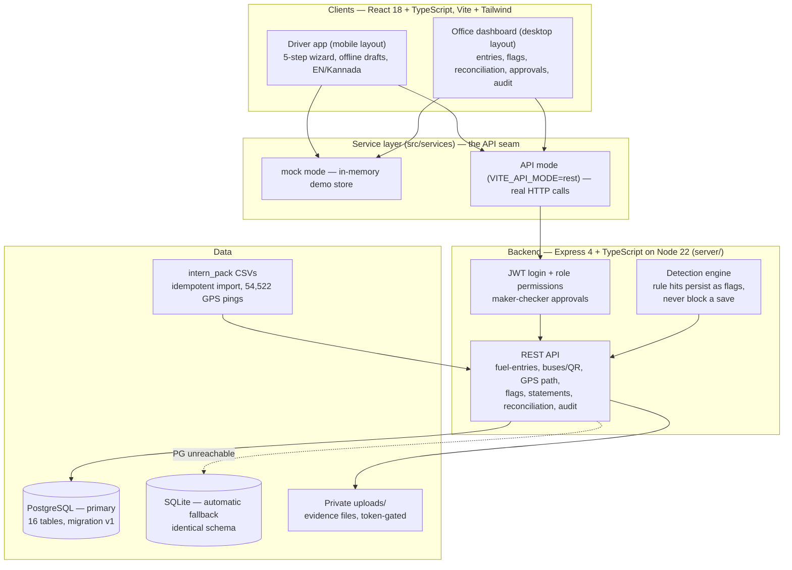

# FleetFuel Guard

**Fuel accountability for Vidyanagara PU College** — a mobile-first fuel-entry app for drivers,
a desktop fleet-monitoring dashboard for the office, and a real backend (PostgreSQL primary with
automatic SQLite fallback, JWT auth + RBAC,
idempotent CSV import, detection engine, reconciliation) built on the synthetic Aug–Oct 2026
diesel dataset (8 buses, 112 register fills, 82 pump statement lines, 54,522 GPS pings).

> **Important framing:** the app surfaces *discrepancies* with independent evidence and asks a
> human to review them. It never labels a transaction "fraud confirmed". Suspicious items are
> always marked **Needs review** / **Discrepancy detected**, and "amount at issue" is never
> presented as a confirmed loss.

---

## 1. Quick Start

### Frontend (demo / standalone mock mode)
```bash
# From the repository root (FuelGuard/)
npm install
npm run dev        # → http://localhost:5173  (demo/mock mode, no backend needed)
npm run build      # TypeScript check (tsc -b) + production build to dist/ (zero errors)
npm run preview    # Serve dist/ locally
npm run smoke      # 25 detection-engine + reconciliation smoke checks (exits 0 = all pass)
```

### Backend (real database + APIs)
```bash
cd server
npm install
npm run dev        # boots on http://localhost:4000 — imports all 7 CSVs, seeds demo data
npm run smoke      # 67 end-to-end API checks on a throwaway database
npm run import     # re-run the idempotent CSV import manually
```

To run the **frontend against the real backend** (persistent records, server-side
permissions), copy `.env.example` to `.env.local`, set `VITE_API_MODE=rest`, start
the backend, and open the frontend as usual. Login is then username-based: `admin`, `driver`, `manager`,
`accountant`, `principal`, password `demo123`. Without that env file the app stays in
demo/mock mode (in-memory, instant evaluation).

---

## 2. Deploy to Render (Blueprint)

[](https://render.com/deploy?repo=https://github.com/shreyabhat75/FuelGuard)

The repository root [`render.yaml`](render.yaml) creates the complete stack automatically in Singapore:

- `fleetfuel-guard-web` — static Vite/React site with SPA client-side routing rewrites (`/* → /index.html`)
- `fleetfuel-guard-api` — Node/Express web service with `/api/health`
- `fleetfuel-guard-db` — PostgreSQL 18 database, connected through Render's private network

### Blueprint Steps:
1. Sign in at [dashboard.render.com](https://dashboard.render.com).
2. Select **New + → Blueprint**.
3. Connect the repository `shreyabhat75/FuelGuard` and select the **`main`** branch.
4. Render detects `render.yaml`. Review the three services and click **Apply**.
5. Render generates the database, wires private connection strings, and deploys both backend and frontend.
6. Detailed guide & troubleshooting: [`docs/Render-Deployment.md`](docs/Render-Deployment.md).

---

## 3. System Architecture

One React codebase, two experiences; one Express API; one database engine with a safety net.



---

## 4. Tech Stack

**Frontend (`src/`)**

| Layer | Technology | Version | Purpose |
|---|---|---|---|
| Framework | React | 18.3.1 | Core UI component hierarchy |
| Language | TypeScript | 5.5.4 | Strict typing across state & API models |
| Build Tool | Vite | 5.4.8 | Lightning fast HMR & production bundler |
| Routing | React Router | 6.26.2 | Role-guarded paths & deep link handling |
| Styling | Tailwind CSS | 3.4.13 | High contrast, responsive & mobile design |
| Charts | Recharts | 2.12.7 | Fuel spend, consumption & efficiency analytics |
| Icons & QR | Lucide React / qrcode.react | 0.441 / 4.0.1 | Accessible iconography & bus QR generation |

**Backend (`server/`)**

| Layer | Technology | Purpose |
|---|---|---|
| Runtime | Node.js 22 | Server environment, CSV ingest & smoke tests |
| Framework | Express 4 | REST API routers, token validation & middleware |
| Language | TypeScript | Strictly typed backend routes & serializers |
| Database | PostgreSQL (primary) / SQLite (fallback) | 16-table relational schema with automatic fallback |
| Auth | JWT (`jsonwebtoken`) + bcryptjs | Secure Bearer tokens & credential hashing |
| File Storage | multer / PostgreSQL bytea | Evidence uploads (odometer + receipt photos) |

**Testing:** API smoke suite (67 end-to-end checks on a fresh database) + frontend engine
smoke (24 checks on rules and reconciliation).

---

## 5. User Roles & Accounts

| Role | Demo User | Assigned Bus | Tailored Experience & Default Landing |
|---|---|---|---|
| **Administrator** | System Admin (`@admin`) | Org-Wide Authority | Centralized authentication & credential governance: provision staff/drivers, generate & reset passwords, edit usernames, suspend/activate accounts, add buses, and allocate drivers (`/app` dispatches `AdminDashboard`) |
| **Driver / Pump User** | Hanumanthappa G (`@driver`) | VB-07 | Mobile-first fuel entry app: 5-step wizard, simulated QR scanner, manual bus search, photo capture (odometer + receipt), GPS status, offline mode with pending-sync badge, transaction history, driver profile (`/driver`) |
| **Transport Manager** | Ravi S (`@manager`) | Fleet-wide | Operational fleet dashboard: 7 KPI cards, 8 executive sections, spend & consumption trends, dedicated Bus Efficiency Hub (`/app/efficiency`), flag investigation detail with "Awaiting evidence" workflow, bus roster with printable QR codes (`/app`) |
| **Accountant** | Lakshmi Devi (`@accountant`) | Finance | Financial reconciliation hub: variance KPIs, match category cards, top discrepancy table, statement CSV import, tabbed mismatch filtering, resolution notes (`/app` dispatches `AccountantDashboard`) |
| **Principal / Approver** | Dr. Suresh Rao (`@principal`) | Governance | Executive governance dashboard: pending approvals queue, decision log, spend vs discrepancy metrics, Maker-Checker lock enforcing strict block on self-approval, mandatory justification on all decisions (`/app` dispatches `PrincipalDashboard`) |

---

## 6. Verification & Automated Tests

FuelGuard includes automated test suites across frontend and backend:

```bash
# 1. Frontend compilation
npm run build
# Output: ✓ 2209 modules transformed. Built cleanly in dist/

# 2. Frontend detection engine smoke tests
npm run smoke
# Output: All 25 engine checks passed (112 register entries, 82 statements, Nov price fallback, capacity/rate checks)

# 3. Backend API smoke suite
cd server
npm run smoke
# Output: 53 end-to-end API checks passed on a fresh throwaway database
```

---

## 7. Demo Walkthrough

1. **Driver Experience (`/driver`):**
   - Log in with `@driver` / `demo123` (or any password in mock mode).
   - Use the bottom navigation to access **New Fill** or **Scan QR**.
   - Input pump metrics (litres, amount, odometer) with real-time rate validation.
   - Attach odometer / receipt photos (supports mobile camera `capture="environment"`).
   - Save entry → uploads immediately or saves offline (`Pending sync`) if disconnected.
   - Toggle Kannada (**ಕನ್ನಡ**) in header or Profile for native vernacular UI.

2. **Transport Manager Experience (`/app`):**
   - Log in with `@manager` / `demo123`.
   - Inspect fleet-wide spend, consumption trend charts, and high-severity flags.
   - Access **Bus Efficiency** (`/app/efficiency`) to rank bus economy (km/L).
   - Access **Flagged Fills** (`/app/flagged`) to request evidence or log supervisor notes.

3. **Accountant Experience (`/app`):**
   - Log in with `@accountant` / `demo123`.
   - Automatically lands on **Accountant Dashboard** displaying statement variance (₹5,96,076 vs ₹5,94,826).
   - Access **Statement Reconciliation** (`/app/reconciliation`) to filter mismatched bills, rate discrepancies, and unmatched pump slips.

4. **Principal Governance (`/app`):**
   - Log in with `@principal` / `demo123`.
   - Review pending write-offs and correction proposals in **Approval Inbox** (`/app/approvals`).
   - Enforce Maker-Checker safety rules: approvers cannot approve their own requests; mandatory remarks logged.

5. **Administrator Governance (`/app`):**
   - Log in with `@admin` / `demo123`.
   - Add new drivers, manage usernames, reset passwords, add buses, and allocate bus assignments.
